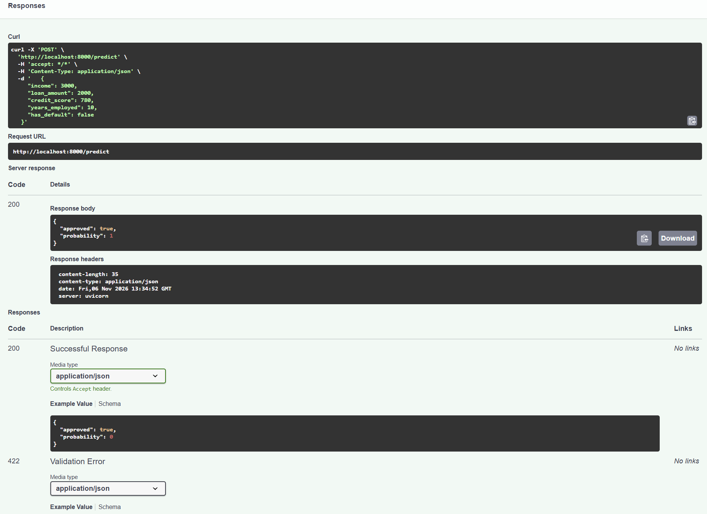

# Checklist - loan-api

Evidence for each requirement of the production image (`Dockerfile.prod`). I ran everything in PowerShell with Docker Desktop on 6 Nov 2026. I put the commands in `collect-evidence.ps1` so I could run them all at once.

## 1. Slim base image and multi-stage build

`Dockerfile.prod` has a `builder` stage that installs the packages and trains the model. The final stage starts from `python:3.12-slim` again and only copies `/opt/venv`, the model and `main.py`.

```powershell
docker build -t loan-api:dev -f Dockerfile .
docker build -t loan-api:prod -f Dockerfile.prod .
docker images loan-api
```

```
IMAGE           ID             DISK USAGE   CONTENT SIZE   EXTRA
loan-api:dev    5d8eeb5b7301        589MB          138MB        
loan-api:prod   dd08bf7f34f9        611MB          143MB
```

The two images are almost the same size. Most of the size is numpy, scipy and scikit-learn, which both need. The difference is what is inside: the prod image has no pytest, httpx, train.py or tests.

## 2. Runs as a non-root user

```powershell
docker run --rm loan-api:prod whoami
docker inspect --format '{{.Config.User}}' loan-api:prod
```

```
app
app
```

## 3. Health check in the image

The `HEALTHCHECK` is in `Dockerfile.prod`, so I did not add one for `api` in `compose.yaml`.

```powershell
docker compose up -d --build
Start-Sleep 35
docker compose ps
```

```
NAME                 IMAGE                COMMAND                  SERVICE   CREATED          STATUS                    PORTS
loan-api-adminer-1   adminer:4            "entrypoint.sh docke…"   adminer   55 minutes ago   Up 55 minutes             0.0.0.0:8080->8080/tcp, [::]:8080->8080/tcp
loan-api-api-1       loan-api-api         "uvicorn main:app --…"   api       40 seconds ago   Up 36 seconds (healthy)   0.0.0.0:8000->8000/tcp, [::]:8000->8000/tcp
loan-api-db-1        postgres:16-alpine   "docker-entrypoint.s…"   db        55 minutes ago   Up 55 minutes (healthy)   5432/tcp
```

api and db are both healthy.

## 4. MODEL_PATH from an environment variable

`main.py` reads `MODEL_PATH`, and the image sets it to `/app/model/model.joblib`.

```powershell
docker inspect --format '{{json .Config.Env}}' loan-api:prod
```

```
["PATH=/opt/venv/bin:/usr/local/bin:/usr/local/sbin:/usr/local/bin:/usr/sbin:/usr/bin:/sbin:/bin","LANG=C.UTF-8","GPG_KEY=7169605F62C751356D054A26A821E680E5FA6305","PYTHON_VERSION=3.12.15","PYTHON_SHA256=c2c4321961fab0fb999d66e0cecf521c2ab3994c7992873ea99e306c1094fd5a","PYTHONDONTWRITEBYTECODE=1","PYTHONUNBUFFERED=1","MODEL_PATH=/app/model/model.joblib"]
```

To check that the variable is really used, I gave it a path that does not exist. The app does not start:

```powershell
docker run --name bad-path -e MODEL_PATH=/app/model/missing.joblib loan-api:prod
```

```
INFO:     Started server process [1]
 
INFO:     Waiting for application startup.
ERROR:    Traceback (most recent call last):
  File "/opt/venv/lib/python3.12/site-packages/starlette/routing.py", line 661, in lifespan
    async with self.lifespan_context(app) as maybe_state:
               ^^^^^^^^^^^^^^^^^^^^^^^^^^
  File "/usr/local/lib/python3.12/contextlib.py", line 210, in __aenter__
    return await anext(self.gen)
           ^^^^^^^^^^^^^^^^^^^^^
  File "/app/main.py", line 19, in lifespan
    state["model"] = joblib.load(MODEL_PATH)
                     ^^^^^^^^^^^^^^^^^^^^^^^
  File "/opt/venv/lib/python3.12/site-packages/joblib/numpy_pickle.py", line 650, in load
    with open(filename, 'rb') as f:
         ^^^^^^^^^^^^^^^^^^^^
FileNotFoundError: [Errno 2] No such file or directory: '/app/model/missing.joblib'

ERROR:    Application startup failed. Exiting.
```

(`GPG_KEY` comes from the official Python image. It is a public key, not a secret.)

## 5. Pinned dependencies

```powershell
Get-Content requirements.txt
```

```
fastapi==0.143.0
uvicorn==0.34.0
scikit-learn==1.6.1
joblib==1.4.2
numpy==2.2.2
psycopg[binary]==3.2.4
```

pytest and httpx are only in `requirements-dev.txt`. Searching for them in the image gives nothing:

```powershell
docker run --rm loan-api:prod pip list | Select-String -Pattern "pytest|httpx"
```

```
(no output)
```

## 6. No secrets in the image or the repo

`.dockerignore` keeps `.git`, `.env`, tests, caches and the compose/sql files out of the build. Only `main.py` and the model are in `/app`:

```powershell
docker run --rm loan-api:prod ls -la /app
```

```
total 16
drwxr-xr-x 1 root root 4096 Nov  6 10:16 .
drwxr-xr-x 1 root root 4096 Nov  6 10:18 ..
-rwxr-xr-x 1 root root 2520 Nov  6 09:03 main.py
drwxr-xr-x 2 root root 4096 Nov  6 10:16 model
```

```powershell
docker history --no-trunc loan-api:prod | Select-String -Pattern "password|secret|token"
```

```
(no output)
```

```powershell
git grep -nIiE "password|secret|token"
```

```
README.md:91:- **Pinned dependencies** and a strict `.dockerignore`, so no tests, caches or secrets go into the image.
compose.yaml:9:      DATABASE_URL: postgresql://loan:loan_dev_password@db:5432/loans
compose.yaml:18:      POSTGRES_PASSWORD: loan_dev_password   # development only
```

The only password is the development database password in `compose.yaml`, which the task allows. The README line just has the word "secrets".

## 7. Trivy scan

```powershell
docker run --rm -v /var/run/docker.sock:/var/run/docker.sock aquasec/trivy:latest image --severity HIGH,CRITICAL --no-progress loan-api:prod
```

Result: Debian packages 49 HIGH, 0 CRITICAL. Python packages 0 HIGH, 0 CRITICAL.

### Notes on the findings

Fixed: my first scan found 3 HIGH in starlette 0.41.3 (CVE-2025-62727, CVE-2026-48818, CVE-2026-54283). Starlette comes with FastAPI, so I upgraded FastAPI from 0.115.6 to 0.143.0, rebuilt and scanned again. The Python packages now have 0.

Not fixed yet: the other 49 are all in Debian packages from the `python:3.12-slim` base. Trivy shows no fixed version for any of them (status `affected`, and `fix_deferred` for perl). The image already runs `apt-get upgrade`, so I can only fix them by rebuilding after Debian releases the patches.

- CVE-2026-76642, CVE-2026-78408, CVE-2026-78409, CVE-2026-78410 - util-linux packages (bsdutils, libblkid1, liblastlog2-2, libmount1, libsmartcols1, libuuid1, login, mount, util-linux). No fix yet. These are mount/nsenter tools that the app does not use, and it runs as non-root.
- CVE-2026-119373, CVE-2026-119374, CVE-2026-119379 - libsqlite3-0. No fix yet. The app uses PostgreSQL, not SQLite.
- CVE-2026-16742 - libsystemd0, libudev1. No fix yet. It is about systemd-homed, which does not run in a container.
- CVE-2025-69720 - ncurses (libncursesw6, libtinfo6, ncurses-base). No fix yet. Terminal library, not used by the API.
- CVE-2026-54369 - libacl1. No fix yet. Needs local symlink access.
- CVE-2026-76844, CVE-2026-85091 - zlib1g. No fix yet. Python needs zlib so it cannot be removed.
- CVE-2026-9538 - perl-base. Debian deferred the fix. The app does not use Perl.

## Publish to Docker Hub

```powershell
$DOCKER_USER="sovannchakriya"
docker tag loan-api:prod $DOCKER_USER/loan-api:1.0.0
docker tag loan-api:prod $DOCKER_USER/loan-api:latest
docker push $DOCKER_USER/loan-api:1.0.0
docker push $DOCKER_USER/loan-api:latest
```

Both tags are on https://hub.docker.com/r/sovannchakriya/loan-api/tags

## Run from Docker Hub

I deleted the local images and ran the one from Docker Hub:

```powershell
docker compose down
docker rmi $DOCKER_USER/loan-api:1.0.0 $DOCKER_USER/loan-api:latest loan-api:prod
docker run --rm -p 8000:8000 $DOCKER_USER/loan-api:1.0.0
```

Then I sent this to `POST /predict` in `/docs` and got 200:

```json
{
  "income": 3000,
  "loan_amount": 2000,
  "credit_score": 780,
  "years_employed": 10,
  "has_default": false
}
```


